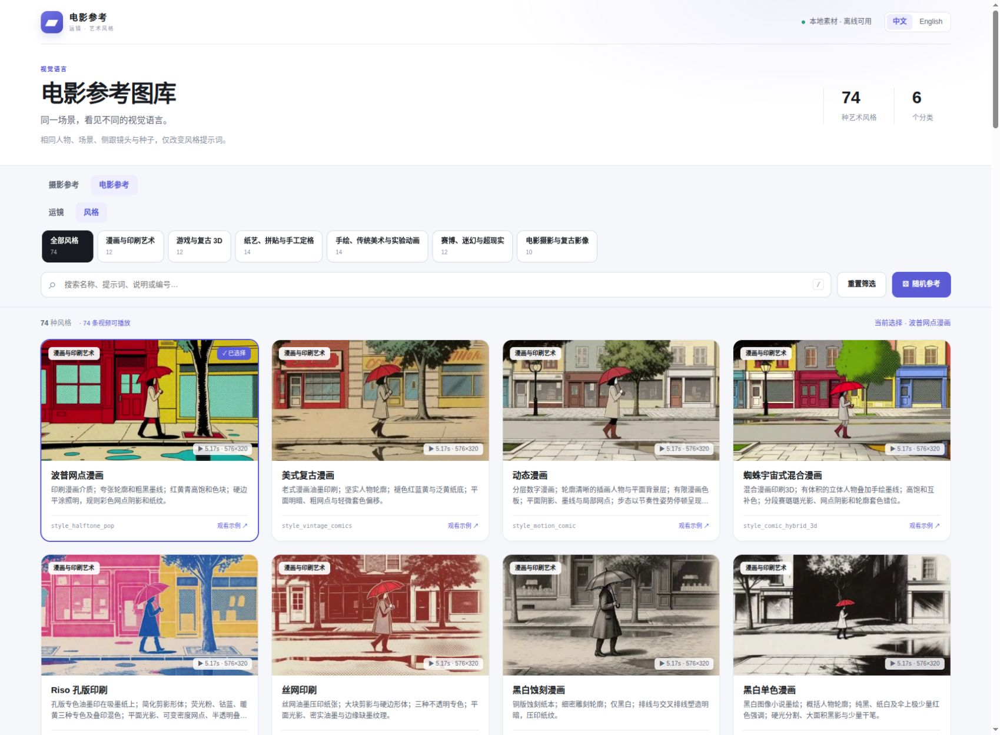

# comfyui-cinematic-gallery

ComfyUI 摄影参考与电影参考插件。**110 张摄影参考图、114 条电影参考视频（40 条运镜＋74 种艺术风格）**，全部素材随插件提供，离线可用。


## 安装与使用

1. 将完整的 `comfyui-cinematic-gallery` 文件夹复制到 `ComfyUI/custom_nodes/`，保留 `library/` 和 `web/`。
2. 重启 ComfyUI，并刷新浏览器。依赖为 ComfyUI 已使用的 Pillow、NumPy、PyTorch 和 aiohttp；不需要模型下载或额外的前端构建。
3. 添加 **image → Photography Reference → 摄影参考**。
4. 点击 **浏览摄影参考图库**，按分类、中英文关键词或素材编号搜索。
5. 点击卡片查看大图与提示词，再点击 **使用此参考 → ComfyUI**。返回节点后手动运行工作流。

图库也可通过同一 ComfyUI 服务的 `/cinematic_gallery/gallery` 独立浏览。独立页面的“选择此参考”仅改变当前页面的选择；将素材写回节点需要从节点打开图库。

## 摄影参考节点：五个输出

| 输出 | 类型 | 内容与连接方式 |
| --- | --- | --- |
| `prompt_zh` | STRING | 当前素材的中文提示词；连接接受文本的节点 |
| `prompt_en` | STRING | 原始英文提示词；例如连接 CLIP Text Encode 的文本输入 |
| `image` | IMAGE | 当前素材的 RGB 原图；连接 Preview Image 或其他图像节点 |
| `description_zh` | STRING | 中文说明 |
| `description_en` | STRING | 英文说明 |

若文本输入仍显示为手填文本框，可在目标节点将该输入转换为连接口后连线。插件本身不接收 CLIP，也不输出 CONDITIONING 或 MASK。

`reference_id` 默认 `camera_arri`，标识保持与原素材一致；`language` 默认 `zh`，可切换为 `en`。中英文界面切换不改变上述输出，五个输出始终来自同一张被选中的素材。编号和语言随 ComfyUI 工作流保存、恢复。插件使用独立节点、前端扩展名和 `/cinematic_gallery/` 路由，可与 ToolBox、Pose Gallery 同时安装；不替换其原节点或自动转换旧工作流。

## 电影参考节点：五个单语输出

添加 **video → Cinematic Reference → 电影参考**，点击“浏览电影参考图库”。同一图库顶部可切换“摄影参考”和“电影参考”；两个节点只接受对应类型的素材。

电影参考内部可切换 **运镜／风格**，两组分别保留搜索、分类和当前选择。运镜包含 **40 条可播放视频、7 个分类**：基础运动、跟随运动、组合轨迹、揭示与穿越、光学与时间效果、视角与机位、剪辑组合。你列出的摇镜、移镜、横移、升降镜、环绕镜、变焦推拉、手持抖动、甩镜、主观、航拍、光学变焦、前跟、侧跟、过肩、高低角度、虫眼、旋转、顶拍、揭示、穿越、拉焦、子弹时间、螺旋上升等名称均可通过名称或别名检索。

艺术风格共 **74 条视频、6 类**：漫画与印刷艺术 12、游戏与复古 3D 12、纸艺与手工定格 14、传统美术与实验动画 14、赛博迷幻与超现实 12、电影摄影与复古影像 10。“荧光纸艺拼贴”拆为平面荧光剪纸与立体荧光纸雕，旧称可同时检索两项。风格详情提供视觉特征、使用场景和易混淆风格说明。



**界面和输出只使用当前所选语言**。选择 `zh` 显示并输出中文，选择 `en` 显示并输出英文；不再并列显示两段中英提示词。卡片、大图说明、通用提示词和完整示例都跟随语言切换。底层仍保存两种语言，切换不丢失编号和筛选。

| 序号 | 输出 | 类型 | 内容 |
| --- | --- | --- | --- |
| 0 | `prompt` | STRING | 当前语言的通用运镜词或艺术风格词 |
| 1 | `image` | IMAGE | 所选视频的 RGB 封面 |
| 2 | `description` | STRING | 当前语言的说明、常用场景；风格另含辨析 |
| 3 | `example_prompt` | STRING | 当前语言的完整场景示例提示词 |
| 4 | `video` | VIDEO | ComfyUI 原生视频，可连接 Save Video 或 Get Video Components |

点击卡片观看视频，可暂停、拖动进度、下载 MP4，并分别复制通用提示词和完整示例。只有“使用此运镜／风格 → ComfyUI”写回当前节点，浏览和播放不会自动排队生成。选择和语言随工作流保存。

视频均为 **576×320（约 0.184MP）、24fps、无声 H.264 MP4**，时长在 5—10 秒之间。由本地 H3 Ref2VA INT8 生成，保留实际提示词、种子、参数与校验值；没有用静态图片缩放替代移机。镜头示例体现运动类型，具体角度与人物细节由模型生成。

74 种风格使用同一个“女性撑伞沿街行走、相机平行侧跟”的基础场景，种子固定为 `202611040001`；每条 124 帧、约 5.17 秒。共同提示词不指定写实、胶片或固定光照；仅艺术风格段变化。黑白色板会将场景中的红伞映射为灰阶，监控、家庭录像及等距设计均保留共同侧跟机位，便于比较影像外观。

输入名继续保留 `motion_id`，界面显示“参考编号”；`style_` 开头的稳定编号自动恢复到风格分组。五个输出类型与顺序不变，视频依然是原生惰性读取对象。可导入 `example_workflows/style_preview.json`（或同名 API 版）查看风格封面和视频。

摄影节点的原五个双语输出保持兼容。旧八口电影节点的界面工作流载入时会自动合并并重接到新的五个口；两个旧语言输出都连接到当前语言的对应输出。旧 API JSON 需按上表更新端口序号。示例 `example_workflows/motion_preview.json` 及同名 API 版已使用新端口。

## 浏览操作

- **单选图库**：景别 10、角度 9、相机 7、焦距 7、景深 9、灯光 13、色彩 14、质感 8、风格 17、艺术家 16，共 110 项。
- **双语搜索**：同时匹配中英名称、提示词、说明和编号；输入多个空格分隔关键词时需要全部匹配。
- **语言切换**：保留搜索、分类和当前素材；摄影详情展示中英提示词；电影详情和文本输出只显示所选语言。
- **随机参考**：在当前筛选结果的可用图片中随机查看；有多个候选时避开当前大图。随机查看与打开卡片都不会写回节点。
- **重置筛选**：清空搜索和分类，保留已选素材。
- **大图详情**：支持前后切换、复制中英提示词、下载原图；按 Esc 关闭，左右方向键切换大图，`/` 聚焦搜索。
- **写回选择**：只有“使用此参考”会更改节点素材；不自动运行、排队，也不拼装主体、负向或多项参数。


## 素材与错误处理

```text
comfyui-cinematic-gallery/
├── __init__.py          # 插件注册
├── nodes.py             # 五输出节点
├── catalog.py           # 目录、图片和校验
├── routes.py            # 只读图库接口
├── web/                 # 节点扩展与图库界面，无构建步骤
└── library/
    ├── catalog.json     # 双语名称、提示词、说明及稳定编号
    ├── SOURCE.json      # 来源及图片校验值
    └── images/          # 110 张 JPG 原图
```

图像保留原尺寸：108 张为 1024×572，2 张为 1024×585。节点输出标准 `[1, H, W, 3]` float32 RGB Tensor，范围 0–1。无效编号、缺失文件、符号链接或损坏图片明确报错，不会用黑图替代；图库中加载失败的图像无法点击使用。若文件缺失，请重新复制完整插件。缓存指纹包含图片内容和该素材文本，替换原图后再次执行会更新输出。

图库仅使用内置素材，不含上传、编辑、删除或提示词拼装。艺术风格视频与封面位于 `library/styles/videos/` 和 `library/styles/posters/`，统一对照条件及基础提示词校验值位于 `library/styles/profile.json`。印刷、定格、转绘等是 AI 对视觉语言的模拟，并不代表实际使用这些物理制作工艺。同一种子用于固定初始噪声，不保证不同风格下人物身份或每个像素完全一致。

电影运镜视频与封面位于 `library/motions/videos/` 和 `library/motions/posters/`；目录中的生成记录保留实际提示词、随机种子、参数与视频校验值。
